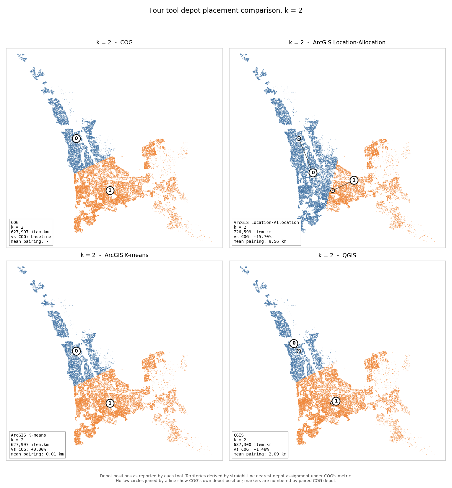
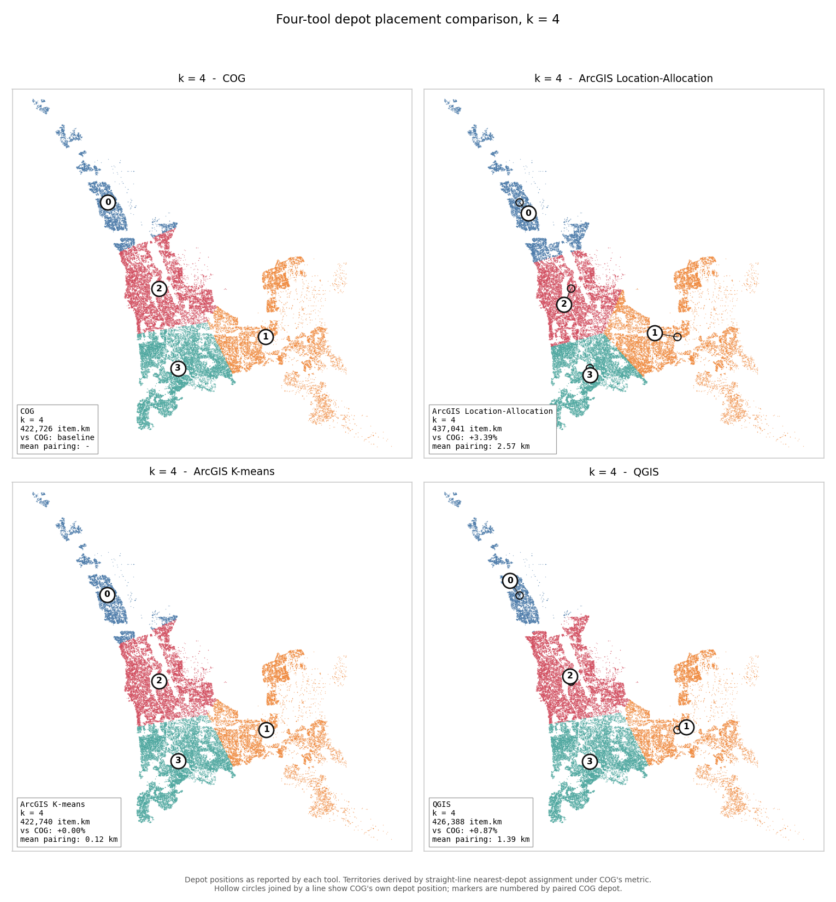
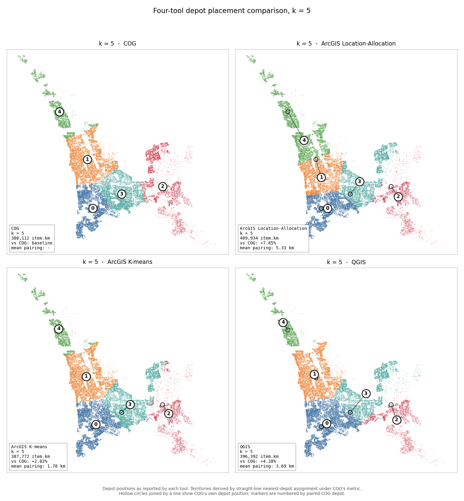
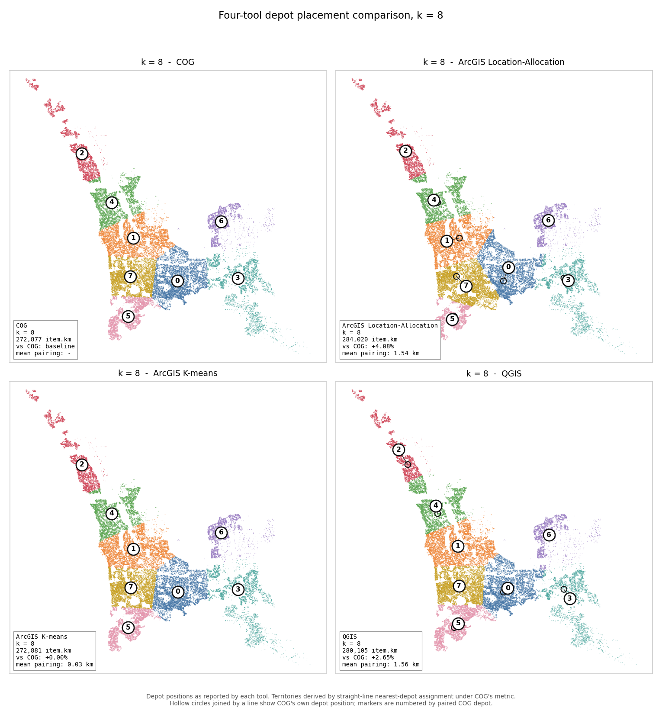
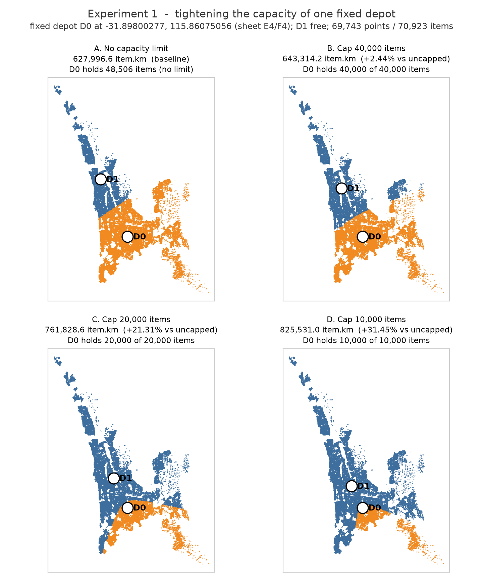
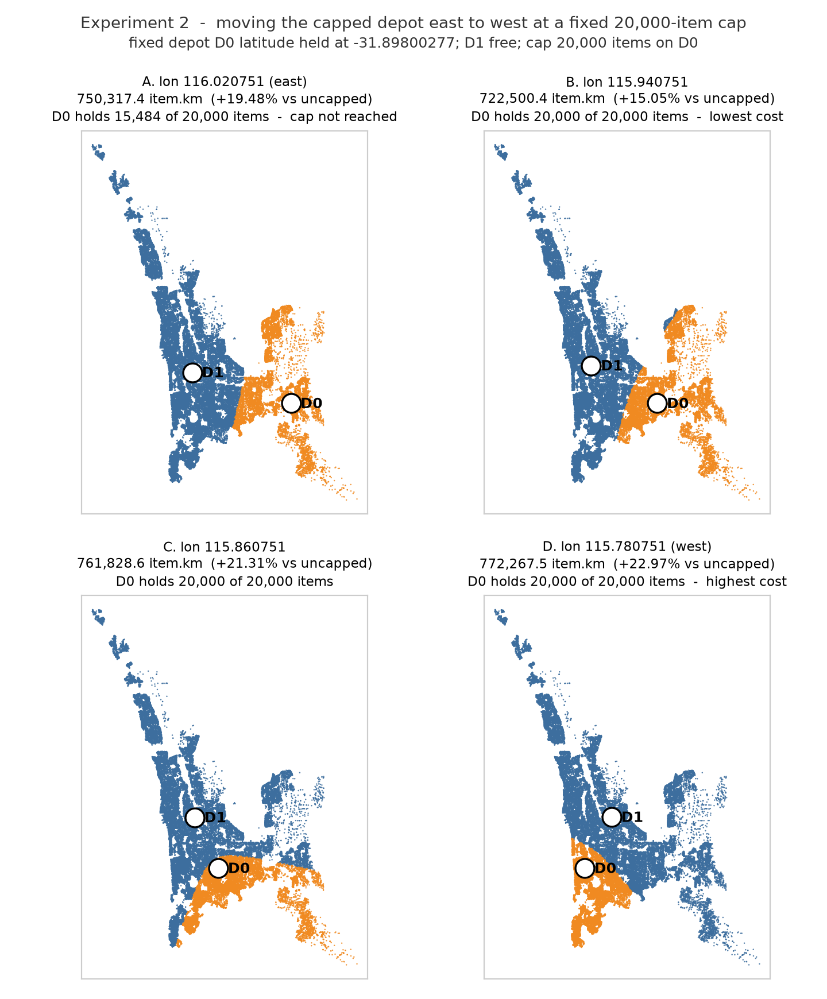
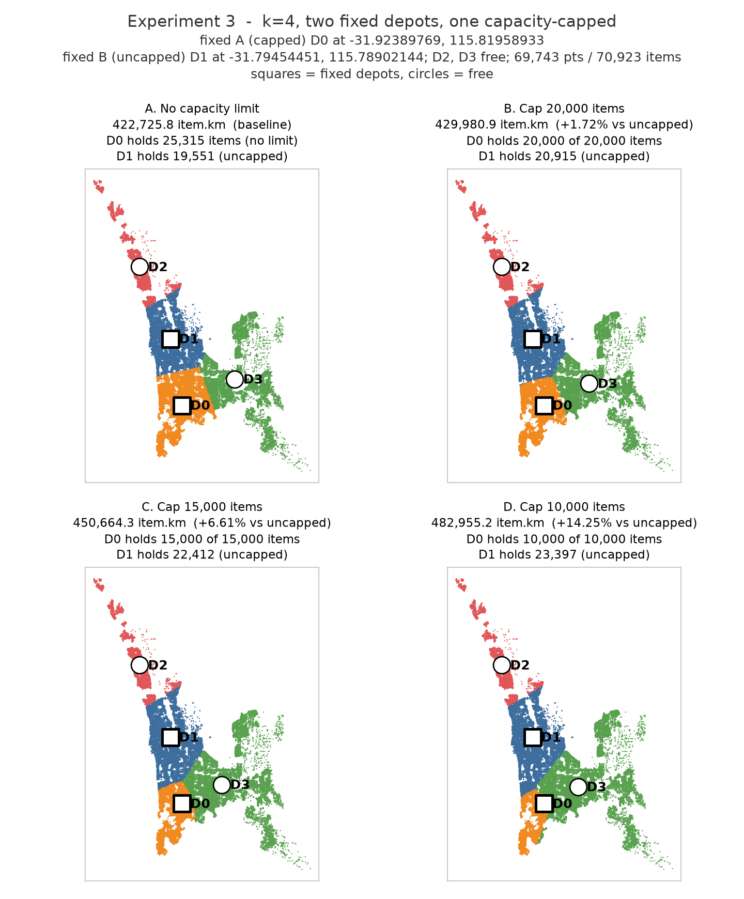

# Depot-Location Validation — Four-Tool Comparison

## 1. Executive summary

This report answers one question: can the depot placements produced by COG,
the in-house depot-location tool, be trusted? To test this, the same problem
was solved on the same dataset by three independent methods — ArcGIS
Location-Allocation, ArcGIS K-means, and QGIS — and all four sets of depot
locations were scored with a single shared metric. If independent methods
land close to COG, the tool is doing what it claims; if they land far away,
something is wrong.

They land close. QGIS places depots within 0.9–4.3% of COG's cost at every
depot count tested, and ArcGIS within 3.4–15.7% while optimising a different
objective — road-network travel time rather than straight-line distance
(Section 5.3). A fourth run, ArcGIS's own K-means solver on the same
straight-line objective COG uses, reproduces COG's cost to within 0.00–2.02%
— the closest match in the study. Four different methods, built by different
people on different logic, arrive in the same neighbourhood.

The comparison also produced a finding with direct planning value: the
number of depots moves cost several times more than the choice of siting
tool. Going from two depots to eight cuts total cost by 56.55% under the
study metric; switching between the best and worst tool at a fixed depot
count changes it by at most 15.70%. The average gap to COG across the four
depot counts all three external methods solved is 2.32% for QGIS, 7.75% for
ArcGIS Location-Allocation and 0.50% for ArcGIS K-means. The expensive
decision is how many depots to operate, not which software sites them.

*One caveat governs everything in this report: the shared metric is COG's
own objective (demand × straight-line distance), so COG cannot lose on it.
The correct claim is therefore that COG is validated — tracked to within a
few percent by three independent methods — not that COG is best. No
tool-neutral metric exists for this comparison.*

## 2. Data and scope

All runs use a single input file: 69,743 delivery points in the northern
Perth metropolitan area carrying 70,923 demand items. Demand is nearly
uniform — the average point carries 1.017 items, and the middle 50% of
points all carry exactly one — a property that matters for one of the
findings below. Every tool ran on exactly this file, and point counts were
verified in every scenario for every tool.

Five depot counts were solved: k = 2, 4, 5, 6 and 8. The ArcGIS runs cover
k = 2, 4, 5 and 8; k = 6 was added later in COG and QGIS only. The visual
comparison in Section 7 shows the four scenarios common to all four tools.

## 3. Method: one ruler for four tools

COG reports its objective in
demand-weighted straight-line kilometres (item·km). ArcGIS Location-Allocation
reports total road-network travel time, in seconds. ArcGIS K-means reports
its own straight-line-based cost, already close to but not identical to
COG's units before re-scoring (Section 5.3). QGIS reports no cost figure at
all — it partitions points into clusters and stops. Kilometres cannot be compared
with seconds, and neither can be compared with a tool that reports no cost
at all, so the tools' native outputs cannot be placed side by side.

Each tool's depot
coordinates — its actual answer — were re-scored under one shared ruler:
every one of the 69,743 points was assigned to its nearest depot, and demand
× straight-line kilometres was summed. The same points, the same assignment
rule, the same formula for all four tools. The only thing that differs
between the columns of the results table is where each tool placed its
depots.

The disclosure repeated from the executive summary: this ruler is COG's home
objective. Scored instead in network seconds, ArcGIS would likely lead,
because that is what it optimised.

## 4. Results

The table gives each tool's total cost under the shared metric, and each
external tool's gap to COG. All figures were reproduced at the terminal from
the production solver and verified against per-depot sums; the gap,
pairing-distance and Δ points columns in the companion workbook are live
formulas.

| k | COG (item·km) | QGIS (item·km) | QGIS vs COG | ArcGIS L-A scored (item·km) | ArcGIS L-A vs COG | ArcGIS K-means (item·km) | K-means vs COG |
|---|---|---|---|---|---|---|---|
| 2 | 627,997 | 637,300 | +1.48% | 726,599 | +15.70% | 627,997 | +0.00% |
| 4 | 422,726 | 426,388 | +0.87% | 437,041 | +3.39% | 422,740 | +0.00% |
| 5 | 380,112 | 396,392 | +4.28% | 409,934 | +7.85% | 387,772 | +2.02% |
| 6 | 340,613 | 347,149 | +1.92% |    —    |    —   |    —    |    —   |
| 8 | 272,877 | 280,105 | +2.65% | 284,020 | +4.08% | 272,881 | +0.00% |

Runtimes are not comparable across tools because they measure different
work: QGIS spends roughly 0.2 seconds on a single unweighted partition; COG
spends 25–41 seconds running ten full optimisation starts and keeping the
best; the ArcGIS runs took around twelve minutes each, most of it routing
every delivery through the real road network. 

## 5. Findings

### 5.1 COG is validated

QGIS tracks COG to within 0.87–4.28% at every k, and its cluster shapes are
nearly identical to COG's on the map (Section 7). A tool with a defect — a
wrong formula, a broken assignment step, a units error — does not track
that closely across five scenarios. Every tool's per-depot point counts sum
to 69,743 in every scenario, confirming each point is assigned exactly once.
That check does not mean the tools agree depot-for-depot: ArcGIS's own
per-depot counts differ from a straight-line reconstruction by up to 2,000
points at k = 4, because it allocated on a different metric. QGIS's
equivalent drift is at most 27 points at every k.

### 5.2 Depot count outweighs tool choice

Under COG's column, eight depots serve the same customers at 56.55% lower
cost than two. Across the results table, the largest tool-to-tool
difference at any single k is 15.70% (ArcGIS at k = 2), and most are under
5%. Even against that largest gap, the depot-count decision is worth 3.6
times more; against the average gap to COG across the four depot counts
all three external methods solved (2.32% for QGIS, 7.75% for ArcGIS
Location-Allocation, 0.50% for ArcGIS K-means) it is worth 7 to 24 times
more. However it is measured, the
depot-count decision dominates the siting-tool decision. Depot workload
also balances naturally as the network grows: the largest depot's share of
demand falls from 68.4% at k = 2 to 35.7%, 27.0% and 18.7% at k = 4, 5 and 8.
The 56.55% and these workload shares are both straight-line results and
should be read as directional — real road distances and real sites will
compress the 56.55% — but the conclusion that depot count dominates tool
choice is robust to how the comparison is made.

### 5.3 Why the ArcGIS Location-Allocation gap is largest at k = 2

ArcGIS selected from a fixed shortlist of roughly 1,000 locations, generated by dividing the 69,743 delivery points into 1,000 clusters and averaging each cluster's coordinates — the method as described by the operator; the list itself was not supplied. A pool built the same way is dense enough to be almost costless: restricted to it, the best achievable two-depot solution lands under 0.15% above COG's unconstrained answer, and COG's own optimal depots each sit within about 700 m of an available site. Restricted to only the 13 sites ArcGIS demonstrably had available, a +5.95% solution existed; it returned +15.70%.

The gap is therefore attributable to the objective, not the shortlist. ArcGIS optimised road-network travel time, so it solved a harder and more realistic problem and was then scored on a metric it did not target — placing both k = 2 depots near the region's centre latitude, 12 km apart on an east–west axis, which is poor under straight-line distance and coherent under road time. Its gap narrows as k grows (+15.7% at two depots to +4.1% at eight) because the two clusterings converge as the network is subdivided more finely, not because a fixed list becomes less binding.

The planning implication stands regardless: COG's totals are a theoretical floor,
not an achievable target. COG may place a depot anywhere, including locations where
no facility could exist, so the day a real site is leased part of that gap is paid
back.

A second ArcGIS run using its K-means solver, rather than the location solver, tests
this directly. K-means optimises straight-line distance and places each centre at the
demand-weighted median of its cluster — the same objective and the same centring rule
COG uses. At k = 2 its depots land within 10 m of COG's (0.01 km and 0.00 km apart).
Re-scored under COG's metric, K-means reproduces COG's objective to within 0.01% at
k = 2, 4 and 8 (+0.00% at each), with no paired depot more than 200 m from COG's. The
exception is k = 5, at +2.02%, consistent with the instability described in Section 5.4.

Same tool, same data, same candidate geography — only the objective differs. That
isolates the +15.70% at k = 2 to the location solver's road-network objective,
an inference offered earlier in this section and now demonstrated directly. Like the
location-solver results, these figures are transcribed from an independently produced
run and have not been re-executed.

### 5.4 k = 5 is a hard configuration

ArcGIS Location-Allocation spikes at k = 5 relative to the neighbouring depot counts
— +7.85% against +3.39% at k = 4 and +4.08% at k = 8. (Location-Allocation's largest
gap overall is at k = 2, for the reason in Section 5.3; the k = 5 spike is local, not
its worst case.) ArcGIS K-means, which matches COG almost exactly at every other k
(+0.00%), also diverges here, at +2.02% — the only depot count where it does.
QGIS's k = 5 result is the least stable in the study: the reported
+4.28% uses farthest-points seeding, while two k-means++ runs of the same tool
scored +1.11% and +2.31% and landed depots 7.7 km apart (Section 6). One tool
swinging three percentage points at a single depot count while barely moving at
the others is the stronger signal — the five-depot problem on this geography has
several competing near-equal solutions rather than one clear best, and +4.28%
should be read as one sample from a spread. Any five-depot proposal should be
solved repeatedly and compared, not accepted from a single run.

## 6. Reproducibility

Every COG figure in this report was reproduced at the terminal from the
production solver. COG's runs use ten fixed seeds and are deterministic: as
a regression gate, the k = 2 scenario was re-solved during this work and
matched the recorded objective to six decimal places (627,996.592167
item·km). QGIS results use farthest-points seeding, which was verified at
source-code level to contain no random number generator and to be
deterministic for a fixed input file; its alternative k-means++ seeding was
excluded because it exposes no seed control — two identical k = 5 runs
scored +1.11% and +2.31%, a spread comparable to the gaps this study
measures. The ArcGIS results (Location-Allocation and K-means, run
separately) are transcribed exactly from their independently produced runs
and have not been re-executed. A companion workbook lists
every one of the 69,743 points with the depot it is assigned to under the
shared metric at each k, so every per-depot count derived under that
metric can be audited down to individual points; each tool's own reported
counts come from its own allocation and are transcribed rather than
reconstructed (Section 5.1).

The Section 7 figures and `figure_data.csv` are produced by the same
principle applied to rendering: a script runs every tool's depots through
one identical projection → nearest-depot → per-depot pipeline with no
randomness anywhere in it, so two independent runs on the same inputs
produce byte-identical PNGs. Before producing a
single figure, the script asserts that its own reconstruction of COG's
per-depot results matches this report's Section 4 numbers: exactly on
point counts, and to within 0.1 item·km.

## 7. Visual comparison — four-tool depot placement

Each figure below renders the full 69,743-point dataset four times in a 2×2
grid — COG, ArcGIS Location-Allocation, ArcGIS K-means, QGIS — under an
identical projection, colour scale and marker styling: only the depot
positions differ between panels, so any visual difference is attributable to
siting alone.

Legend: depot markers are white-filled circles labelled with the index of
the paired COG depot (the optimal bipartite matching by haversine distance
in workbook note 1), so the same number means the same COG depot in every
panel. On the ArcGIS and QGIS
panels, small hollow black circles connected by a thin line show COG's own
depot position and how far the paired depot sits from it.

**Figure 1 — k = 2.** COG 627,997 · ArcGIS Location-Allocation 726,599 (+15.70%) ·
ArcGIS K-means 627,997 (+0.00%) · QGIS 637,300 (+1.48%) item·km. Mean pairing
distance: Location-Allocation 9.56 km, K-means 0.01 km, QGIS 2.09 km. COG and
QGIS both divide the region north/south — COG's two depots are 17.4 km apart
north–south but only 9.6 km east–west, QGIS's 19.3 km against 12.0 km — while
ArcGIS Location-Allocation splits east/west instead (2.5 km north–south, 11.6
km east–west). This is the largest structural disagreement in the study, and
the same scenario as Location-Allocation's largest objective gap (workbook
note 2). K-means reproduces COG's
objective exactly and places both depots within 10 m, so the visible difference
in the Location-Allocation panel is attributable to its road-network objective
rather than to the candidate shortlist (Section 5.3).

**Figure 2 — k = 4.** COG 422,726 · ArcGIS Location-Allocation 437,041 (+3.39%) ·
ArcGIS K-means 422,740 (+0.00%) · QGIS 426,388 (+0.87%) item·km. Mean pairing
distance: 2.57 km, 0.12 km, 1.39 km.

**Figure 3 — k = 5.** COG 380,112 · ArcGIS Location-Allocation 409,934 (+7.85%) ·
ArcGIS K-means 387,772 (+2.02%) · QGIS 396,392 (+4.28%) item·km. Mean pairing
distance: 5.33 km, 1.78 km, 3.69 km — a local spike for ArcGIS
Location-Allocation and the least stable QGIS result in the study (finding
5.4). One Location-Allocation depot sits 10.32 km from its paired COG depot,
nearly twice the mean for this scenario, and visibly reshapes the eastern
corridor split. This is the only depot count at which K-means diverges from
COG, consistent with the several competing near-equal
solutions described in Section 5.4.

**Figure 4 — k = 8.** COG 272,877 · ArcGIS Location-Allocation 284,020 (+4.08%) ·
ArcGIS K-means 272,881 (+0.00%) · QGIS 280,105 (+2.65%) item·km. Mean pairing
distance: 1.54 km, 0.03 km, 1.56 km, medians 0.96 km, 0.02 km and 1.20 km — the
only depot count at which ArcGIS Location-Allocation's placements sit closer
to COG's than QGIS's do.

*All figures: depot positions as reported by each tool. Territories are derived
by straight-line nearest-depot assignment under COG's metric; ArcGIS allocated by
road-network travel time, so its implied point counts differ from its own export
— by up to 2,000 points at k = 4 (Sections 3 and 5.1). Full per-depot numbers
behind every figure are in the companion `figure_data.csv` (Section 10).*

## 8. Capacity constraint sensitivity

The Fixed + Variable solver supports a hard capacity limit on each fixed depot. This
section reports how the algorithm behaves when that limit is varied, and when a
capped depot is moved. Three experiments were run, all on the Malaga PDC dataset
(69,743 delivery points, 70,923 demand items). Experiments 1 and 2 use one fixed and
one free depot; Experiment 3 uses two fixed and two free.

Nine of these runs (Experiments 1 and 2) were executed through the application;
Experiment 3 (Section 8.5) was run via script against the same production solver.
Objective values are quoted as reported by the solver in both cases.

### 8.1 How the constraint works

The cap is a hard limit on **demand in items**, applied to fixed depots only; free
depots remain unlimited. A hard limit cannot be exceeded at any cost, so the solver
cannot simply assign every delivery point to its nearest depot.

Assignment is solved as a minimum-cost flow. Each demand item is a unit of flow, each
depot is a sink with limited capacity, and the cost of routing a unit is its demand
multiplied by the straight-line distance to the depot. The solver finds the cheapest
feasible way to move all 70,923 items while respecting every limit exactly — for
this flow solve itself. Whether the final returned assignment always honours every
cap is a separate question, addressed in Section 9.

The resulting optimum is **not** nearest-depot assignment. Each capped depot acquires
a price representing the marginal cost of its scarce capacity, and every point is
served by whichever depot minimises **distance + that depot's price**. Once a depot is
full its price rises, so points physically closer to it are served from further away.

This is why catchment boundaries under a capacity limit are offset rather than straight
bisectors, and why individual points can appear assigned to the "wrong" depot. The
interlocking territories are the signature of the constrained optimum, not an
assignment error.

### 8.2 Experiment 1 — varying the capacity of a fixed depot

The fixed depot is pinned at **-31.89800277, 115.86075056**, the southern k=2 COG
depot from the validation workbook (cells E4/F4). One free depot is allowed to
relocate. Unconstrained, the fixed depot attracts 48,506 items.

| Cap (items) | Objective (item·km) | vs uncapped baseline | Marginal cost of the previous 10,000 | Fixed depot holds | Free depot relocates to |
|---|---|---|---|---|---|
| uncapped | 627,996.6 | — | — | 48,506 items / 47,698 pts | -31.741346, 115.758953 |
| 50,000 | 627,996.6 | 0.00% | — | 48,506 of 50,000 | -31.741346, 115.758953 |
| 40,000 | 643,314.2 | +2.44% | +15,318 | 40,000 of 40,000 | -31.766321, 115.780293 |
| 30,000 | 693,722.4 | +10.47% | +50,408 | 30,000 of 30,000 | -31.795078, 115.795566 |
| 20,000 | 761,828.6 | +21.31% | +68,106 | 20,000 of 20,000 | -31.817208, 115.808225 |
| 10,000 | 825,531.0 | +31.45% | +63,702 | 10,000 of 10,000 | -31.838836, 115.818230 |

**The cap is not reached above the depot's natural catchment.** At 50,000 items the cap
exceeds the 48,506 the depot would take anyway, and the result is identical to the
unconstrained run in every respect, including the free depot's coordinates. A capacity
limit only has an effect once it falls below what the site would otherwise attract.

**The cost of displacement rises as the depot is squeezed.** Reducing the cap from
50,000 to 40,000 displaces 8,506 items and costs 15,318 item·km, about 1.8 km per item
displaced. Each subsequent 10,000-item reduction costs 5.04, 6.81 and 6.37 km per item.
The first tranche of capacity is cheap to give up because it was barely being used; once
the depot is genuinely constrained, each further item displaced costs roughly three and a
half times as much.

**The network compensates by contracting.** As the limit tightens, the free depot moves
steadily toward the capped depot to intercept the displaced demand — from 19.90 km away
unconstrained to 16.50, 13.00, 10.26 and 7.71 km at caps of 40,000 down to 10,000. The
two depots end up less than half as far apart as they began.

### 8.3 Experiment 2 — moving a capped depot east to west

Here the capacity is held at **20,000 items** and the depot's position is varied
instead. Latitude is held at -31.89800277 and longitude is stepped in 0.08 degree
increments, approximately 7.6 km apart. All four positions lie within the delivery
footprint.

| Fixed depot longitude | Objective (item·km) | vs uncapped baseline | Fixed depot holds | Free depot relocates to |
|---|---|---|---|---|
| 116.020751 (east) | 750,317.4 | +19.48% | 15,484 of 20,000 | -31.848879, 115.802980 |
| 115.940751 | **722,500.4** | +15.05% | 20,000 of 20,000 | -31.837968, 115.795187 |
| 115.860751 | 761,828.6 | +21.31% | 20,000 of 20,000 | -31.817208, 115.808225 |
| 115.780751 (west) | **772,267.5** | +22.97% | 20,000 of 20,000 | -31.816669, 115.840308 |

**Position changes total cost by 49,767 item·km, or 6.89%, at identical capacity.**
The same 20,000-item cap produces a total of 722,500 item·km at the best position
tested and 772,268 at the worst. Capacity and siting are therefore not independent
decisions.

**The cap does not bind at the eastern position** — the depot attracted only 15,484 of
its 20,000 allowance, because demand thins that far east. Its +19.48% is therefore
entirely a location penalty, not a capacity one. The worst position is the westernmost,
where the capped depot serves a compact coastal catchment while the free depot inherits
the entire eastern half of the network including the long south-eastern tail; that
long-haul work drives the objective to its highest value in this experiment.

### 8.4 Interpretation

Three points follow for depot planning.

Capacity limits are cheap until they bind, then expensive quickly. There is a
threshold — here around 60% of natural catchment — below which each further reduction
costs substantially more than the last.

The cost of a limit is governed by how much demand it displaces, not by the size of
the limit itself. The same 20,000-item cap is 1.53 times as costly at one site as at
another (144,271 vs 94,504 item·km above the uncapped baseline), purely because of
how much volume the site would otherwise have attracted.

Siting and capacity should be decided together. A capped facility performs best where
its natural catchment approximately matches its capacity, which is not the same as the
point that minimises distance alone.

As a validation check, the unconstrained run in Experiment 1 returns **627,996.6
item·km**, identical to the two-depot COG result recorded in the validation workbook.
Pinning one k=2 depot and allowing the other to relocate recovers the unconstrained
two-depot optimum exactly, confirming that the Fixed + Variable solver and the Multi
Depot solver agree where their scenarios coincide.

### 8.5 Experiment 3 — k = 4, two fixed depots

This experiment extends the capacity test to k = 4. Two of COG's four k=4 depots are
pinned: D0 (-31.92389769, 115.81958933) is capacity-capped; D1 (-31.79454451,
115.78902144) is pinned but uncapped. D2 and D3 are free. Unlike Experiment 1's single
fixed depot, only one of the two pinned depots here is capacity-constrained — the
other anchors a second fixed site without a demand limit.

Uncapped, D0 attracts 25,315 items and D1 attracts 19,551 — together 63% of the
network's 70,923 items. The combined objective, 422,725.8 item·km, matches Section 4's
COG k=4 result (422,726) exactly. Pinning two of the four optimal depots and freeing
the other two recovers the four-depot optimum, the same check Section 8.4 makes at
k = 2.

| Cap (items) | Objective (item·km) | vs uncapped | Marginal (per step) | D0 holds | D1 holds |
|---|---|---|---|---|---|
| uncapped | 422,725.8 | — | — | 25,315 (no limit) | 19,551 (uncapped) |
| 26,000 | 422,725.8 | +0.00% | — (cap not binding) | 25,315 of 26,000 | 19,551 (uncapped) |
| 20,000 | 429,980.9 | +1.72% | +7,255 (Δ6,000) | 20,000 of 20,000 | 20,915 (uncapped) |
| 15,000 | 450,664.3 | +6.61% | +20,683 (Δ5,000) | 15,000 of 15,000 | 22,412 (uncapped) |
| 10,000 | 482,955.2 | +14.25% | +32,291 (Δ5,000) | 10,000 of 10,000 | 23,397 (uncapped) |
| 5,000 | 517,458.7 | +22.41% | +34,504 (Δ5,000) | 5,001 of 5,000 | 21,094 (uncapped) |

**The tightest cap produces a real, observed violation.** At 5,000 items, D0 finishes
with 5,001 — one item over its cap. This is the split-repair defect described in
Section 9, previously characterised only in isolated unit tests; here it appears in a
returned production result. The overshoot is 0.02% and did not recur at
any looser cap in this sweep, consistent with the defect's known trigger (a point's
demand split across depots by the flow solve, then repaired whole onto one of them).

Displaced demand goes mostly to the free depots, but not entirely. A second fixed
site changes who absorbs the overflow: in Experiment 1's single-fixed-depot case only
the free depot could take it, whereas here the pinned uncapped depot competes for it
on distance despite never moving. D1 takes 1,364 of the first 5,315 items D0 sheds
(26%), and 3,846 of 15,315 at the 10,000-item cap (25%) — a consistent minority share,
with the free depots absorbing the rest. At the tightest cap that share collapses:
D1 takes only 1,543 of the 20,314 items displaced (8%), falling back from its 23,397
peak to 21,094 even as D0 sheds more. Once D0's catchment is squeezed hard enough, the
free depots relocate far enough to undercut D1 on distance for demand it previously
held. The mechanism was not investigated further here.

## 9. Limitations and open items

- **The shared metric is COG's own objective.** No tool-neutral alternative
  exists, so these results support validity, not superiority.
- **ArcGIS was not run at k = 6.**
- **ArcGIS's location-solver selection mechanism is undocumented.** How the solver
  chooses among its candidate pool was not explained by the operator, so its placements
  cannot be reproduced independently. The pool is dense enough to be almost costless
  (Section 5.3), and the K-means comparison in that section attributes the k = 2
  divergence to the objective, so this is a reproducibility limitation rather than an
  unexplained result.
- **All distances are straight-line.** The mirror-image test — scoring COG's
  depots under network travel time — remains the outstanding validation step.
- **Capacity is characterised and the split repair is instrumented but not fixed.**
  Sections 8.2–8.3 report nine runs across two experiments in which every cap was
  respected exactly. Section 8.5 adds a third experiment at k = 4 in which one run
  (a 5,000-item cap) returned a depot 1 item over its limit — the same split-repair
  defect, now observed in a returned result rather than only in unit tests. The
  overshoot is 0.02% of the cap and did not recur at any other tested level. The
  solver logs cap-overflow statistics per run, but these reflect the last internal
  solve inside the multi-start search rather than the returned solution, and are
  not a reliable compliance check; the only reliable check is comparing each
  depot's realised demand against its cap directly in the output, which is what
  Section 8.5 does. Anyone taking a capacity-capped result forward should perform
  that check themselves rather than rely on the logged stats.

## 10. Companion artifacts

Two workbooks accompany this report. The validation workbook contains the
full per-depot results for COG, ArcGIS location-allocation, ArcGIS K-means and
QGIS, with live gap formulas and four method notes. The assignments workbook lists all 69,743 points with
coordinates, demand, and the depot assigned under the shared metric at
each of the five depot counts, one column per k, so a point's depot
membership can be traced as the network grows.

A third artifact, `figure_data.csv`, lists every reconstructed and reported
number behind every Section 7 figure — one row per tool per depot per k:
lat, lon, reconstructed points and item·km, each tool's own reported points
and its own reported weight in that tool's native unit, the workbook's
transcribed Δ points, and the haversine pairing distance to COG.
`CAPTIONS.md` gives one paste-ready caption per figure. Both are generated
by the same figure-generation script referenced in Section 6, so every
number in the Section 7 captions is traceable to it rather than read off
the images.
